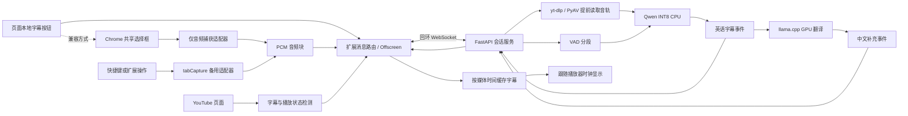

# YouTubeLocalSubtitles 技术方案

版本：0.2.0 开发预览

日期：2026-11-10

关联需求：[PRD](PRD.md)

状态：核心实现已进入开发预览；受控浏览器和模型小样本已验证，完整验收状态见 [验证记录](VERIFICATION.md)。

## 1. 技术栈决定

| 层级 | 第一版选择 | 原因与边界 |
| --- | --- | --- |
| 平台 | Windows x64 + 当前稳定版 Chrome，Manifest V3 | 优先服务本机使用；最低兼容 Chrome 116，但验收必须记录实际版本 |
| 扩展开发 | TypeScript、Vite、多入口构建、原生 DOM/CSS | 控件少，避免引入完整页面框架；本地打包全部脚本 |
| 页面检测 | Content script + 尽量小的 MAIN world 适配脚本 | 页面播放器数据与扩展逻辑隔离；适配层可能随 YouTube 更新 |
| 默认音轨来源 | yt-dlp 解析公开音轨，PyAV 按媒体 PTS 提前解码 | 不采集画面，不等待原视频播放后才识别，不导出登录 Cookie |
| 兼容按钮采集 | 用户主动选择后的 `getDisplayMedia` + Chrome 共享选择框 | 仅用于明确选择的兼容方式，保留处理延迟说明 |
| 备用捕获 | 快捷键/扩展 action → `tabCapture` → offscreen document | 通过扩展调用授权启动；不是普通页面按钮的无提示替代品 |
| 音频处理 | Web Audio API、AudioWorklet、单声道 16kHz PCM16 | 在工作线程处理，避免主线程按块阻塞 |
| 本机服务 | Python 3.12、FastAPI、Uvicorn、WebSocket、NumPy | 会话控制、PCM 接收、模型调度；单机单活动音频会话 |
| 语音活动检测 | sherpa-onnx + Silero VAD | 减少静音推理，按语音段提交识别 |
| 首选 ASR | Qwen3-ASR-0.6B INT8 ONNX，sherpa-onnx CPU 最多 3 线程 | 给浏览器留出 CPU 调度余量，不假定 INT8 自动走 CUDA |
| ASR 对照 | faster-whisper，small.en INT8 与需要时的 large-v3-turbo GPU 方案 | 在同一测试集比较延迟/质量；不默认同时安装全部模型 |
| 翻译运行时 | llama.cpp 的 Windows CUDA `llama-server` | 独立进程，本地 HTTP 调用，支持量化模型 |
| 首选翻译模型 | Qwen3-4B-Instruct-2507，GGUF Q4_K_M 候选 | 使用不输出思考过程的指令模型；准确性和内存须实测，不声称其为专门翻译模型 |
| 环境与测试 | uv / Python 依赖锁、npm 锁；pytest、Vitest、真实 Chrome 验证 | 固定依赖与模型制品版本，测试关键行为 |
| 本地启动 | PowerShell 脚本 | 不强制 Docker、WSL、Ollama 或 LM Studio；暂不做桌面壳 |

翻译基座来自 [Qwen 官方模型](https://huggingface.co/Qwen/Qwen3-4B-Instruct-2507)；可评估 [Unsloth GGUF 转换](https://huggingface.co/unsloth/Qwen3-4B-Instruct-2507-GGUF)。下载时须确认实际文件名、量化类型、修订号、校验值及许可证，不能把第三方量化版本标成官方权重。

模型属于可替换后端，扩展不绑定具体模型。技术栈已定，ASR/翻译的最终制品由基准结果定版。

## 2. 架构与职责



- Content script：注入按钮、观察播放器、字幕叠加、持有页面按钮方案的捕获流。
- MAIN world 适配器：只读取必要的播放器元数据，输出经校验的小型状态消息；不接触配对令牌。
- Service worker：权限入口、快捷键、状态路由；不持有模型、不承担持续音频运算。
- Offscreen document：备用路径的捕获、音频处理及本机连接；页面路径接收显式音频消息并转发。
- 本机服务：鉴权、单会话管理、VAD、识别、翻译队列、过期结果丢弃。
- llama-server：仅提供本机文本翻译推理，不接收音频。

页面持有的 `MediaStream` 不可直接通过 `chrome.runtime` 的 JSON 消息传给 offscreen。页面按钮方案应在持有流的上下文转换为 PCM，再通过长连接 Port 分块转发；运行时序列化开销必须在原型测量。

## 3. 捕获方案与权限

### 3.0 默认音轨预读路径

页面主按钮发送 `source: prefetch` 的会话，不调用媒体捕获 API。服务只接收当前 YouTube videoId，独立解析该公开视频的音轨，再由 PyAV 按音频帧的 PTS/time_base 取得媒体时间并重采样为 16kHz。

每段初始约 4 秒，目标提前准备未来约 20 秒。识别与翻译完成后立即送入前端缓存，不立即显示；前端在 requestVideoFrameCallback 中使用原生视频时间选取 `[media_start, media_end)` 内的字幕。未来字幕等待，过期字幕不闪现，暂停保持原区间，跳转后复用对应缓存。服务缓存最多 64 段，客户端最多 256 段。

当前视频的进度、速率和播放状态通过 `session.position` 更新；这不控制播放器。程序不暂停、回退或改变原视频速率来等待模型。首次准备仍需时间；来源失败时明确提示，不静默降级为画面采集。需登录来源不通过导出浏览器 Cookie 处理。

### 3.1 兼容页面按钮路径

`getDisplayMedia` 必须直接由用户点击触发；不能先等待异步网络健康检查导致瞬时用户激活失效。服务健康状态应提前缓存在界面，捕获后再确认握手。

请求偏向当前浏览器标签页并包含音频；视频选项是 API 所需，程序只读取音频，不读取、编码、上传或保存视频帧。是否可以立即停止无用视频轨道而不中断音频，要在原型验证后再决定。

用户可能仍能选到其他页面。使用 Chrome 可用的捕获句柄能力校验当前标签页：目标页面以随机会话标识配置 Capture Handle，选择后检查捕获轨道的 handle/origin，确认其匹配本次目标。具体兼容性属于首个技术验证门槛；不能可靠校验时拒绝含糊的选择并提示使用快捷键的定向 `tabCapture` 路径，不能悄悄转录别的标签页。

没有音频轨道时立即停止所有轨道并提示开启“共享标签页音频”。不得悄悄改成录麦克风。保留 Chrome 停止共享按钮，并监听 `ended` 事件。

0.2.0 已验证：核对 Capture Handle 后停止视频轨道，音频可以继续。因此兼容方式保留音频轨道并立即释放无用画面来源。默认路径则完全不创建这类捕获流。

### 3.2 备用路径

通过 Chrome commands 的快捷键或扩展 action 启动 `tabCapture.getMediaStreamId`，由 offscreen 消费该 ID。必须把捕获音频正确接回扬声器，否则可能造成视频静音；只连接一次，结束时断开并释放资源。

页面按钮的提示可以展示已配置快捷键；不模拟按键，不使用调试协议绕过权限。

### 3.3 权限最小集合

- 站点范围限制为所支持的 YouTube 主站点及本机服务地址。
- 扩展 API：`storage`、`offscreen`、`tabCapture`、`activeTab`；只有代码确实使用时才加入 `scripting`。
- `commands` 使用 manifest 声明，不把它误写成 permissions 条目。
- 不申请全站访问、麦克风、cookies、debugger 或整个桌面采集权限。
- AudioWorklet 模块若需通过扩展 URL 被页面访问，仅暴露必要资源并限定 YouTube 匹配规则；检查 CSP/CORS 是否满足。

参考：[捕获官方指南](https://developer.chrome.com/docs/extensions/how-to/web-platform/screen-capture)、[tabCapture](https://developer.chrome.com/docs/extensions/reference/api/tabCapture)、[activeTab](https://developer.chrome.com/docs/extensions/develop/concepts/activeTab)、[Capture Handle](https://developer.chrome.com/docs/web-platform/capture-handle)。

## 4. 字幕检测与会话状态

字幕检测返回 `present | absent | unknown`。播放器数据尚未对应当前 videoId、响应缺失、页面接口异常或仅找到不可靠 DOM 信号时返回 unknown。

优先从当前播放器响应提取字幕轨道，核对 videoId；DOM/CC 菜单仅作为辅助交叉检查。缺少字段不直接推断 absent。检测有短暂等待和有界重试，初始预算 5 秒，可在实测后调整。YouTube 单页导航后必须重新检测。

YouTube IFrame API 文档没有提供满足主站扩展需求的稳定字幕轨道列表契约；本项目不把站内内部字段当成官方长期接口。[IFrame API 说明](https://developers.google.com/youtube/iframe_api_reference)

会话状态与捕获状态分开，避免“暂停识别”被误实现成“停止共享”：

```text
捕获：idle → requesting → capturing → ended
推理：disabled / waiting_captions / native_captions /
      waiting_playback / loading / recognizing / degraded / error
```

只有以下条件同时满足才提交音频：

```text
捕获有效 && 本地字幕已启用 && 服务就绪 && 正文播放中
&& (确认没有字幕 || 用户手动强制开启)
```

广告、暂停、缓冲、未知字幕状态都暂停提交。切换目标标签页采用显式接管，先停止旧会话再启动新会话，第一版不并发转录多个视频。

## 5. 音频分段与时间

本节的播放音频 PCM 方案只用于兼容方式。默认路径从媒体文件的原始时间戳得到字幕区间，不以音频网络到达时间或识别完成时间代替媒体时间；显示规则见 3.0。

- 捕获音频混为单声道；用有状态重采样器转为 16kHz，不用简单隔点抽样。
- PCM16 little-endian；每块初始 100ms，每块约 3.2KB 原始音频。
- 页面消息路径如使用数字数组，记录序列化开销；不能逐采样发送 runtime 消息。
- VAD 初始参数：起始阈值按 Silero 默认附近调试；前置保留 200ms、末尾静音 500ms、最短语音 300ms、最长段 4 秒。最长段切断后的断词问题需评估有限重叠与去重。
- 最长段和 VAD 参数以延迟/准确率实测取舍，配置有界，不允许用户输入造成无限缓冲。
- Qwen ONNX 路径首先使用 VAD + 离线分段模拟实时；不声称是该后端的原生流式解码。
- 字幕时间采用视频媒体时间映射，按分段给出近似时间范围；第一版不宣称词级精确时间戳。

每个会话具有 `session_id`、`video_id`、递增 `generation`。每个音频块具有序号、墙钟单调时间、媒体时间锚点、采样数量和播放速率。

进度跳转、换视频、广告边界、捕获重建或速率变化使 generation 增加；清空 VAD、音频缓存和待处理结果。持续比较 `currentTime` 与音频锚点，检测播放时间不连续。所有字幕与译文携带 generation，页面只接收当前代结果。

倍速播放的捕获音频时长与媒体时间不同，区间映射必须乘播放速率，不能直接用收到的 16kHz 样本数当作视频秒数。

## 6. 模型运行与降级

### 6.1 识别

实现 `AsrBackend.transcribe(samples, sample_rate, language)`，模型加载一次、串行解码。默认使用 CPU 上的 Qwen INT8，以免与翻译抢 GPU 显存。

首选制品为 sherpa-onnx 提供的 Qwen3-ASR-0.6B INT8 ONNX 转换，正式安装前核验实际发布文件和版本。INT8 仅表示量化类型，不代表任意 ONNX CUDA provider 都能执行全部算子。[模型部署说明](https://k2-fsa.github.io/sherpa/onnx/qwen3-asr/pretrained.html)

若实时能力不达标，对同一批音频比较 faster-whisper small.en CPU INT8；质量不足时再测 GPU 路径与不同模型。不能未经测量同时把 ASR 和翻译塞满 8GB 显存。[faster-whisper](https://github.com/SYSTRAN/faster-whisper)

### 6.2 翻译

实现 `Translator.translate(text, recent_context)`。默认 llama.cpp + Qwen3-4B-Instruct-2507 GGUF Q4_K_M，GPU offload、上下文 2048、CPU 线程 2、批处理 128/64、关闭线程忙等，单请求生成，输出长度有界。

输入为当前英语段及最多前两段上下文；要求只翻译当前段，不重复历史、不加解释、不输出思考过程。字幕属于待翻译数据，不能被当成调用工具或修改运行配置的指令。无工具权限，不下载和执行字幕内容。

英文模式不启动翻译；中文或双语第一次启用时按需加载。ASR 结果先发送，翻译以相同 segment_id 补充。翻译超时保持识别工作：双语保留英文，中文模式显示“翻译暂不可用”，由用户选择切换英文，不把英文冒充中文。

若翻译资源或延迟不达标，评估更小模型，记录质量代价；不自动退回云端。[llama-server 官方说明](https://github.com/ggml-org/llama.cpp/blob/master/tools/server/README.md)

### 6.3 队列与生命周期

- 音频环形缓冲初始上限 12 秒；ASR 待处理语音段最多 2 段。
- 翻译待处理最多 2 段，优先当前仍可显示的内容，任务超过 8 秒即标记过期。
- 队列满时丢弃最旧的未开始任务并报告“字幕暂时跟不上”，不能无限积压；统计丢弃比例。
- 原生字幕接管时取消未运行任务并拒绝旧结果；不能立即中断的推理允许完成但不显示。
- 模型空闲 5 分钟后可释放；音频捕获是否继续只由会话授权状态决定。
- 服务正常退出应结束会话和其启动的模型子进程，不终止用户其他模型进程。

## 7. 本机协议草案

FastAPI 默认监听 `127.0.0.1:18765`，翻译进程默认 `127.0.0.1:18766`；均可在本地配置中改端口，不暴露局域网。原计划的 8765/8766 在开发机器上已被其他程序使用，未修改或停止这些程序。

| 通道 | 用途 |
| --- | --- |
| `GET /health` | 仅返回版本及 ready/loading/error 等状态，不暴露文件路径和令牌 |
| `WS /v1/session` | 配对鉴权、会话控制、PCM、识别结果、译文和状态 |

0.2.0 的默认会话带 `source: prefetch`，并区分字幕处理是否允许的 `eligible` 与播放器是否正播放的 `playing`。使用 `session.position` 更新媒体位置。默认不传输捕获 PCM；二进制 PCM 帧仅用于兼容方式。原有不带 source 的客户端按 live 兼容处理。

WebSocket 首个消息必须是带本地配对令牌的 hello，鉴权完成前不创建模型任务、不接收音频；连接超时未鉴权即关闭。核验实际请求 Origin，只允许配对的扩展来源，拒绝网页与空 Origin。CORS 不是 WebSocket 鉴权，不能只靠 CORS 防护。

页面按钮路径由扩展的消息链路连接本地服务，避免把本地令牌暴露到网页 MAIN world。页面消息必须核验来源、会话 nonce、类型、videoId 和长度。Origin 白名单与令牌都存本机，不写进公开仓库。

控制消息示意：

```json
{
  "type": "session.start",
  "session_id": "random-id",
  "video_id": "youtube-video-id",
  "generation": 1,
  "mode": "bilingual",
  "source_language": "en",
  "sample_rate": 16000
}
```

音频采用带固定头部的 WebSocket binary frame，头部包含 generation、序号、媒体时间、速率、采样数。正式布局及字节序在实现时固定并写协议测试，禁止依赖共享可变的“上一条 JSON 头部”。服务限制帧大小、采样数、队列时长和连接数。

结果消息示意：

```json
{
  "type": "caption.source",
  "session_id": "random-id",
  "generation": 1,
  "segment_id": 23,
  "media_start": 42.1,
  "media_end": 45.7,
  "text": "This is an example.",
  "language": "en",
  "final": true
}
```

对应中文使用 `caption.translation`，携带相同 ID、generation、时间范围和 `language: zh`。错误用稳定代码区分 `AUTH_FAILED`、`MODEL_MISSING`、`MODEL_LOADING`、`QUEUE_OVERFLOW`、`TRANSLATION_TIMEOUT` 等，不把原始堆栈直接显示给用户。

## 8. 目录、配置与发布

以下布局已用于核心实现；模型、运行时和本机配置不提交仓库。

```text
YouTubeLocalSubtitles/
  docs/                  PRD、SPEC、后续验收记录
  extension/             Manifest V3、页面控件、捕获适配器
  server/                FastAPI、VAD、ASR、翻译调度
  scripts/               安装、模型下载、启动、停止、诊断
  tests/                 协议、状态切换、模型基准
  models/                本地权重，Git 忽略
  runtime/               本地运行时与临时状态，Git 忽略
  logs/                  不包含观看内容的诊断日志，Git 忽略
  .venv/                 项目 Python 环境，Git 忽略
  config.local.json      配对令牌等本机配置，Git 忽略
```

下载器把缓存、模型及运行时放在 E 盘项目下；对下载使用临时文件、校验和完成后原子改名，失败不把半文件标为可用。不得把访问令牌打印到日志。

首次以 Chrome 开发者模式加载解压扩展；不修改既有个人配置或强制重启浏览器。发布代码只包含源码、锁文件、配置示例和文档。模型单独下载并保留上游许可证；公开仓库不包含测试视频和用户录音。

## 9. 验证与技术门槛

### Gate 1：页面按钮捕获

在当前真实 Chrome 验证：页面点击后出现选择框、正确标签页/音频识别、取消/选错处理、持续 PCM、原声播放、全屏、停止与导航清理。确认 AudioWorklet、CSP、Capture Handle、Port 路由及 offscreen 生命周期可用。

若主路径不能可靠工作，先给出实测原因与可用备用入口，更新设计；不能把工具栏限制隐藏在“自动开启”文案后。

### Gate 2：模型基准

至少覆盖清晰英语、口音、背景音乐、长静音、快速说话、数字与专名。分别测冷启动、预热后识别、翻译、同时运行峰值资源和队列积压。按 PRD 的延迟定义记录分段等待和推理时间。

### Gate 3：行为与连续运行

- 单元测试优先覆盖字幕三态判断、generation 失效、媒体时间/倍速映射、限流与队列溢出、鉴权、模式切换。
- 集成测试覆盖真实 PCM 经模型得到字幕，再由翻译事件补齐；模拟器测试不作为真实模型准确率证据。
- 真实 YouTube 验证有人工字幕、仅自动字幕、无字幕及检测失败四种情况；记录实际视频样本与日期，不把个人观看记录提交仓库。
- 按 PRD A01–A17 记录通过、失败、未验证；连续 20 分钟观察资源和积压。

只有所有 P0 场景通过，才把仓库状态从设计阶段改为可试用。实际版本、模型文件校验、性能数据、已知限制写入验收记录。

## 10. 当前实现补充

- 重采样由 16kHz AudioContext 的浏览器音频引擎执行，AudioWorklet 负责单声道混合和 PCM16 分块。
- `session.pause` 结束当前 VAD 分段并暂停接收新音频，允许已说完的段完成；`session.resume` 使用新的音频时间锚点恢复。它们不使原有已说完结果失效。跳转、换视频、字幕接管等边界仍递增 generation。
- 首次捕获连接完成后重新同步一次播放状态，避免共享选择期间的状态变化造成两端不一致。
- 翻译模型启动中会话结束时，后续请求复用同一受管子进程，避免重复加载和端口争抢。
- 停止脚本遍历已核验的服务进程树，兼容 Windows 虚拟环境 Python 启动器的子/孙进程结构；不停止用户其他模型服务。
- 备用快捷键、真实站点异常矩阵及完整非英语检测尚未全部验证，详见验证记录。
- 扩展 0.1.1 不再把自动字幕元数据当成可用性的充分证据：播放器明确表示不可用且当前字幕模块无轨道时返回 absent；信号矛盾时保持 unknown。单纯关闭 CC 或隐藏控制栏不会覆盖有效字幕轨道。其他视频残留的模块轨道也不能单独证明当前视频有字幕。
- 0.2.0 默认提前解码音轨，不采集正在播放的页面。生产服务及模型使用较低调度优先级，限制推理线程、模型上下文和批处理，给播放留出资源。
- 音轨解析使用 mweb 与本地 BgUtils 2.0.2 脚本，提供匿名播放验证。脚本源码固定为提交 `26475e9d3665b972c4aeb83b4dbaafcf64b88438`，下载归档验证 SHA-256，Python 插件固定同版本；按需运行，没有额外常驻服务。Node 缓存通过 XDG_CACHE_HOME 指向项目 cache，未导出日常浏览器 Cookie。参考 [yt-dlp PO Token 指南](https://github.com/yt-dlp/yt-dlp/wiki/Po-Token-Guide) 和 [助手上游说明](https://github.com/Brainicism/bgutil-ytdlp-pot-provider/tree/2.0.2)。
